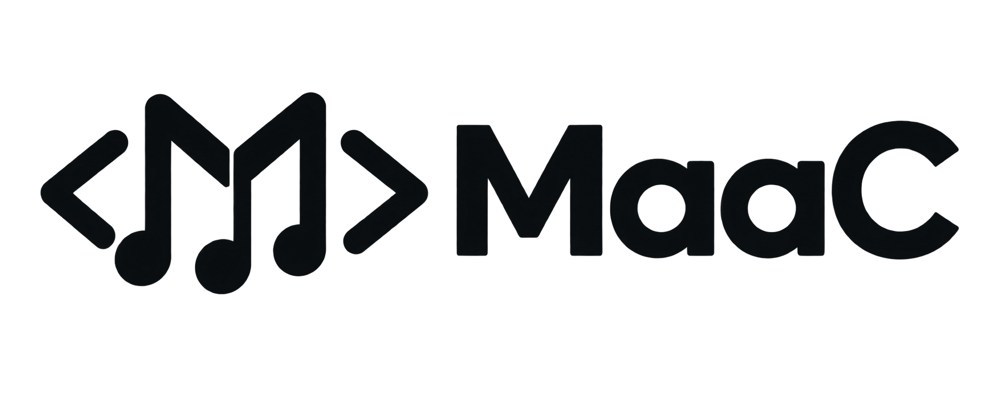
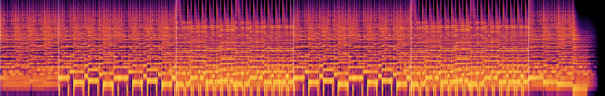
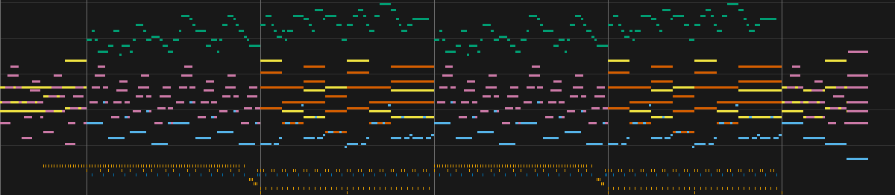

# MaaC (Music as a Code)

[](https://github.com/tksuns12/maac/actions/workflows/ci.yml)
[](LICENSE)
[](CHANGELOG.md)
[](https://www.rust-lang.org)



MaaC is a text language for music, and a Rust command-line tool that turns it
into audio. You write a score, its instruments and its mix as plain `.maac`
source. `maac` checks it, compiles it to an inspectable performance plan and
renders a WAV file. The same source always renders to the same bytes, offline,
with no samples to download.

It is built to be written by people and by AI models alike. `maac analyze`
reports what a render sounds like in numbers: loudness per section, peaks,
octave bands, buried or mistuned notes. A producer who cannot listen can
still check a mix.

**Status:** experimental, version 0.2.0. Tested on macOS and Linux, with
prebuilt binaries for both. The [changelog](CHANGELOG.md) records what has
changed.

## Listen

Two songs written entirely in MaaC source by an AI producer, rendered and
mastered by `maac` with only the built-in instruments:

- **"Morning Ferry"**, a 72 bpm rock ballad with electric guitars, picked
  acoustic guitar, bass, drums and pad (2:17):
  [listen](docs/assets/audio/morning-ferry.m4a) ·
  [source](examples/ferry/ferry.maac)
- **"Late Window"**, a 90 bpm lo-fi hip-hop track with electric piano,
  nylon guitar, bass, drums and pad (1:18):
  [listen](docs/assets/audio/late-window.m4a) ·
  [source](examples/lofi/lofi.maac)

`maac analyze --images` draws what it measures. The spectrogram of "Morning
Ferry"'s master, with its six sections marked:



And its piano roll, one color per part:



## What a score looks like

[`examples/hello.maac`](examples/hello.maac), a piano and a drum kit:

```maac
maac 1;

project hello {
  score = [0q, 16q]; rate = 48000Hz; tail = 3s;
  tempo = &clock; meter = &metre; output = &mix:out;
}
tempo clock { points = [(0q, 84bpm, step)]; }
meter metre { points = [(0q, 4, 4)]; }
import studio { builtin = "std/studio/1.1.0"; }

node piano { instrument = &studio.piano; config = { voices = 16; }; }
node drums { instrument = &studio.drums; }
node mix { type = "core.sum/1"; config = { channels = 2; }; }
connect piano_mix { from = &piano:out; to = &mix:in; }
connect drums_mix { from = &drums:out; to = &mix:in; }

pattern chords { length = 4q;
  chord c { at = 0q; dur = 2q; pitches = [C3, E4, G4]; velocity = 0.6; }
  chord a { at = 2q; dur = 2q; pitches = [A2, C4, E4]; velocity = 0.5; }
}
pattern beat { length = 2q;
  hit kick  { at = 0q; key = "kick";  velocity = 0.7; }
  hit hat   { at = 1/2q; key = "hat"; velocity = 0.4; }
  hit snare { at = 1q; key = "snare"; velocity = 0.6; }
  hit hat2  { at = 3/2q; key = "hat"; velocity = 0.4; }
}
track keys { target = &piano:events; }
track kit { target = &drums:events; }
place progression { pattern = &chords; track = &keys; at = 0q; count = 4; }
place groove { pattern = &beat; track = &kit; at = 0q; count = 8; }
```

Positions and lengths are exact fractions of a quarter note (`q`), so
nothing drifts. Patterns are placed on tracks, tracks feed instrument nodes,
and nodes connect into a mix.

## Install

**Prebuilt binary.** Download the archive for your platform from the
[latest release](https://github.com/tksuns12/maac/releases/latest): macOS on
Apple silicon (`aarch64-apple-darwin`) or Linux on x86_64 or arm64
(`x86_64-unknown-linux-gnu`, `aarch64-unknown-linux-gnu`). Each archive holds
`maac` and the examples, and has a `.sha256` checksum beside it. On a Mac:

```sh
curl -LO https://github.com/tksuns12/maac/releases/download/v0.2.0/maac-v0.2.0-aarch64-apple-darwin.tar.gz
tar -xzf maac-v0.2.0-aarch64-apple-darwin.tar.gz
cd maac-v0.2.0-aarch64-apple-darwin
./maac --version
```

Move `maac` to a directory on your `PATH` to run it from anywhere. macOS
quarantines a binary downloaded with a web browser; run
`xattr -d com.apple.quarantine maac` once to allow it.

**From source,** on any platform with a current stable
[Rust toolchain](https://rustup.rs). Windows and Intel Macs are untested.

```sh
git clone https://github.com/tksuns12/maac.git
cd maac
cargo install --path . --locked
```

This puts `maac` on your path. `maac` never contacts the network.

## Quick start

From the repository root, or the unpacked archive, render the example above
and listen to `hello.wav` in any audio player:

```sh
maac build examples/hello.maac -o hello.wav
```

Hear what the built-in instruments can do with two complete songs, both
written by an AI producer with MaaC:

```sh
maac build examples/ferry/ferry.maac --profile song -o ferry.wav   # a rock ballad
maac build examples/lofi/lofi.maac --profile song -o lofi.wav      # a lo-fi track
```

Ask the analyzer how a render sounds, section by section:

```sh
maac analyze examples/ferry/ferry.maac --profile song --section regions
```

Browse the instruments and their controls:

```sh
maac instruments --library std/studio/1.1.0
maac instruments piano --library std/studio/1.1.0 --json
```

The steps behind `build` are also separate commands:

```sh
maac check examples/hello.maac
maac compile examples/hello.maac -o hello.performance.json
maac render hello.performance.json -o hello.wav --force
```

Renders are 48 kHz float WAV by default; `--format pcm16` writes 16-bit.
Existing files are kept unless you pass `--force`. Long songs need
`--profile song`, which raises the render-work allowance.

## What's included

- **A language for scores:** notes, chords and drum hits with exact timing;
  reusable patterns with transposition and repeats; tempo ramps, meters,
  grooves and named sections. See the [tutorial](docs/tutorial.md).
- **Built-in instruments,** all synthesized and needing no downloads:
  - [studio](docs/studio-instruments.md): electric and acoustic piano,
    electric guitar, bass, pad and drum kit, whose sound follows velocity;
  - [acoustic](docs/acoustic-guitars.md): steel, nylon and muted acoustic
    guitars;
  - [basic](docs/basic-instruments.md): 24 general-purpose sounds.
- **Your own instruments:** oscillators, wavetables, FM, plucked strings,
  resonator banks, filters and saturation, wired as voice graphs with
  controls and presets ([instruments](docs/instruments.md)).
- **Recorded audio:** sample kits, arranged clips with fades, and
  tempo-following warps ([core kit](docs/core-kit.md),
  [audio clips](docs/audio-clips.md)).
- **Mixing and delivery:** EQ, compression, reverb and a limiter, and
  `maac deliver` for masters and stems checked against loudness and peak
  targets ([production](docs/production.md)).
- **Per-note expression:** independent pitch bends, swells, timbre and
  pressure on overlapping notes.
- **Analysis:** loudness, peaks, spectra, stereo image and per-note findings,
  plus spectrogram and piano-roll images ([analyze](docs/analyze.md)).

The [feature tour](docs/features.md) walks through each with a runnable
example, and the [capability matrix](docs/capabilities.md) gives exact
limits.

## Documentation

- **Start here:** [quick start](docs/quickstart.md),
  [tutorial](docs/tutorial.md), [AI producer guide](docs/ai-producer-guide.md)
- **Reference:** [CLI and library reference](docs/reference.md),
  [diagnostics](docs/diagnostics.md),
  [performance-plan format](docs/performance-plan.md),
  [capability matrix](docs/capabilities.md)
- **Language:** the [MaaC/1 specification](MaaC-1-Specification.md), its
  [grammar](spec/grammar.ebnf) and [syntax-tree schema](spec/syntax-tree.schema.json).
  The specification is a design draft; the implementation covers a
  documented subset.
- **Design:** the [design principles](docs/design-principles.md) and the
  [roadmap](docs/language-specification-plan.md#current-priorities).
  Proposals, delivery reports and AI production trials in [`docs/`](docs/)
  record how each feature was decided and measured.

## Contributing

Bug reports, questions and ideas are welcome in
[issues](https://github.com/tksuns12/maac/issues). The
[contribution guide](CONTRIBUTING.md) explains the development setup, the
checks CI runs and the contribution terms. Report security issues privately,
as described in [SECURITY.md](SECURITY.md).

## License

Apache License, Version 2.0; see [LICENSE](LICENSE). Unless a file states
otherwise, this covers the Rust source, specification, grammars, schemas,
examples, tests and documentation. The [NOTICE](NOTICE) file records the
scope and how dependencies' own licenses apply.
